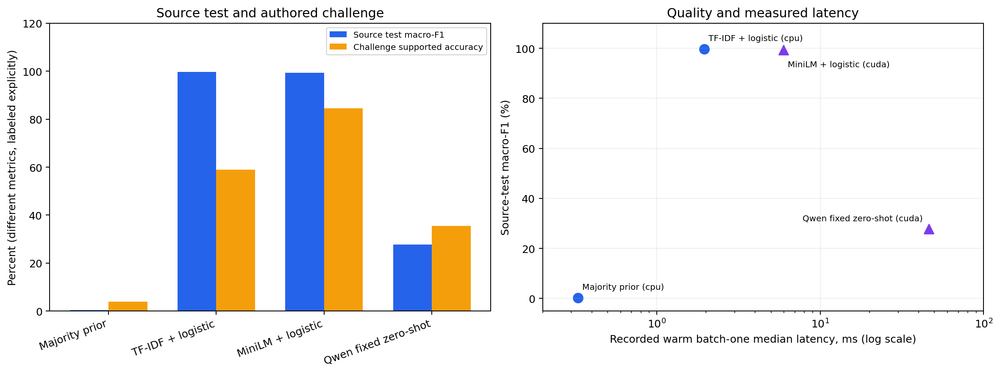

# Support Intent Routing Benchmark

**High source-test scores did not transfer cleanly to new requests.** TF-IDF reached 99.64% macro-F1 on a grouped Bitext test, but 58.89% accuracy on newly written supported requests. Frozen MiniLM embeddings plus a linear classifier reached 84.44% on those requests. The abstention thresholds accepted only 30/180 and 60/180 supported challenge requests respectively.

This portfolio compares a simple prior, a lexical classifier, pretrained embeddings and a fixed instruction-model setup. It includes pinned data, duplicate audits, validation-only selection, final predictions, failure cases, resource measurements and an executed notebook that actually reproduces the TF-IDF model with frozen settings. It was built and independently reviewed with AI-agent assistance; it is not a claim of unaided authorship or production readiness.

[Audited Kaggle dataset](https://www.kaggle.com/datasets/dhruvb2028/support-intent-routing-audited-evaluation) | [Executed benchmark notebook](notebooks/support-routing-benchmark.ipynb) | [Data report](docs/data-report.md) | [Independent review](docs/validation-report.md)

## Results and their limits

| Model | Source test macro-F1 | Supported challenge accuracy, before abstention | Supported challenge accepted | Warm median / p95 ms | Device |
|---|---:|---:|---:|---:|---|
| Majority prior | 0.30% | 3.89% | 0/180 | 0.33 / 0.62 | cpu |
| TF-IDF + logistic regression | 99.64% | 58.89% | 30/180 | 1.95 / 2.76 | cpu |
| Frozen MiniLM + logistic regression | 99.42% | 84.44% | 60/180 | 5.96 / 8.36 | cuda |
| Qwen fixed zero-shot | 27.75% | 35.56% | 0/180 | 46.30 / 50.43 | cuda |

The source test contains 3,570 requests. The separate final challenge contains 180 supported, 60 ambiguous, 30 near-domain unsupported and 30 far-domain unsupported requests. Both are synthetic. On accepted supported challenge requests, TF-IDF was correct on 29/30 and MiniLM on 60/60; most supported requests were deferred. These small accepted samples do not establish perfect reliability. The majority and Qwen thresholds defer everything, so their unsupported rejection rates must be read alongside zero coverage.

TF-IDF deferred 30/30 near-domain and 29/30 far-domain unsupported requests, plus 52/60 ambiguous requests. MiniLM deferred 30/30 in each unsupported slice and 53/60 ambiguous requests. Near-domain rejection was not worse than distant rejection in this sample. Confidence is uncalibrated, and the threshold utility is a declared development choice rather than a measured production cost model.



Warm timings use 100 sequential batch-one requests after five warmups on one Windows machine; MiniLM/Qwen use an NVIDIA GeForce RTX 5060 Laptop GPU, while classical models use CPU. HTTP and model loading are excluded. Device differences limit architecture-only comparisons. A separate one-request fresh-process probe, with model files already cached, measured approximately 3.26 s to first TF-IDF result, 9.32 s for MiniLM and 11.46 s for Qwen. These are descriptive observations, not latency distributions or service guarantees. The resource probe imports common benchmark dependencies, including PyTorch for CPU models; its RSS is not minimum TF-IDF deployment memory. See [resource evidence](results/resource_usage.json).

The fixed Qwen result applies only to one zero-shot 27-way constrained-token prompt/scoring setup. It is not a general comparison of LLM capability. Neither pretrained model was fine-tuned; MiniLM embeddings were fixed while its logistic classifier was fitted.

## What was built

- **Data preparation:** the original 26,872 Bitext requests become 23,826 retained rows in 22,445 groups, split 16,681 / 3,575 / 3,570. Punctuation variants caught by independent review were repaired before final evaluation. Only request text is a feature.
- **Selection and evaluation:** training-only fitted transformations, validation-selected configurations, separate challenge-development threshold selection, a hashed freeze, group-bootstrap source-test intervals and approximate Wilson challenge intervals.
- **Inspectability:** saved predictions, 20 predetermined high-confidence failures per model, separate nonerror diagnostics, pinned model revisions, exact source/data hashes and a local routing demo.
- **Honest scope:** AI-authored challenge and independent AI review; no human annotation or real customer traffic. Source generation families and pretraining contamination cannot be fully ruled out.

[Four technical notes](docs/technical-notes.md) explain the leakage repair, historical inference lesson, quality/latency comparison and abstention findings. [Deep Past retrospective](docs/deep-past-retrospective.md) documents earlier recorded results with community-model attribution and explicitly separates historical evidence from fresh reproduction.

## Run locally

Use Python 3.12. From the project root:

```bash
python -m venv .venv
# Activate .venv using your shell's normal command.
python -m pip install -e ".[notebook,test]"
python scripts/prepare_data.py
python -m pytest
python scripts/build_benchmark_notebook.py
```

The report builder uses the committed result assets, verifies the frozen data, reconstructs metric tables and refits TF-IDF. The source download is required for the full test suite; model artifacts and weight caches are not committed. Its recorded replay achieved 100% label and acceptance agreement on the source test. MiniLM/Qwen metrics and timings in the notebook are recorded artifacts, not freshly rerun inference in that notebook.

To audit committed predictions without downloading or training models:

```bash
python scripts/review_final_outputs.py --allow-missing-model-artifacts
```

This reconstructs the recorded metrics and verifies available source/data/configuration hashes. Missing model binaries are explicitly recorded as unverified; the default strict audit requires those binaries.

To reconstruct source splits from the pinned original, run `python scripts/prepare_data.py`. The challenge authoring program is retained for provenance; final challenge data must remain fixed after outcomes are viewed.

The recorded GPU environment used Windows, Python 3.12 and the official CUDA 12.8 PyTorch wheel. For that environment, install `torch==2.9.1` with `--index-url https://download.pytorch.org/whl/cu128`. The `requirements-lock-windows-cu128.txt` snapshot is Windows-specific and requires that wheel index (for example via `--extra-index-url`); it is not a portable Linux lock. CPU reproduction is supported with the launcher's `--device cpu` option, but full Qwen inference can be slow.

For a full four-model reproduction, the launcher creates a new sibling workspace and runs its own copied preparation, selection, freeze and test scripts:

```bash
python scripts/start_reproduction.py ../support-router-reproduction --run
```

The destination must not already exist. This downloads pinned pretrained weights and requires appropriate compute. Original evidence stays intact. Because the published test outcomes are already known, this is reproduction of a known benchmark, not a new blinded holdout experiment. Do not use those outcomes to tune.

After a completed reproduction has generated its model artifacts, run its local demo:

```bash
python ../support-router-reproduction/app.py
```

The app runs at `http://127.0.0.1:7860` and suggests routing or human review; it does not execute account actions. Directly starting the source repository's app requires local model artifacts, which are intentionally absent from a fresh clone. Kaggle staging builders do not publish anything.

## Evidence and attribution

- [Frozen configurations and hashes](results/frozen_selection.json), [final metrics](results/benchmark.json), [per-model final predictions](results/test), [data provenance](data/manifest.json), [challenge provenance](data/challenge_manifest.json).
- Original source: [Bitext Innovations](https://huggingface.co/datasets/bitext/Bitext-customer-support-llm-chatbot-training-dataset/tree/430d1a89bd93bd1fa23c16f29dd53e73f0087443), under **CDLA-Sharing-1.0**. Prepared data and source examples retain that license and attribution; changes are documented in the data report. The repository's software license does not replace the data license.
- Pretrained weights: [all-MiniLM-L6-v2](https://huggingface.co/sentence-transformers/all-MiniLM-L6-v2/tree/1110a243fdf4706b3f48f1d95db1a4f5529b4d41) and [Qwen2.5-1.5B-Instruct](https://huggingface.co/Qwen/Qwen2.5-1.5B-Instruct/tree/989aa7980e4cf806f80c7fef2b1adb7bc71aa306). Those weights are upstream work; this project trains linear classifiers and implements the benchmark around them.

